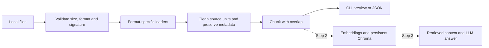

# Step 1 ingestion reference (historical)

This records the initial milestone. See the root README for the current running UI.

**Build status: step 1 of 6 is implemented and runnable.** This milestone validates,
extracts and chunks documents locally. Retrieval, answer generation, web ingestion,
FastAPI, Streamlit and Docker are subsequent milestones; there is no chat endpoint yet.

## Run step 1

Use Python 3.11 or newer. No API keys, model downloads, Ollama server or network access
are needed for extraction after installing dependencies.

From this directory in PowerShell:

```powershell
py -3 -m venv .venv
.\.venv\Scripts\python.exe -m pip install -r requirements-dev.txt
Copy-Item .env.example .env
.\.venv\Scripts\python.exe -m app.cli samples/handbook.md samples/products.xlsx --preview
.\.venv\Scripts\python.exe -m app.cli samples/policy.pdf --output output/chunks.json
.\.venv\Scripts\python.exe -m pytest -q
```

On macOS/Linux:

```bash
python3 -m venv .venv
.venv/bin/python -m pip install -r requirements-dev.txt
cp .env.example .env
.venv/bin/python -m app.cli samples/handbook.md samples/products.xlsx --preview
.venv/bin/python -m app.cli samples/policy.pdf --output output/chunks.json
.venv/bin/python -m pytest -q
```

For extraction only, install `requirements.txt` instead of `requirements-dev.txt`.
To install the optional `rag-ingest` console command, run `python -m pip install -e .`
inside your activated virtual environment. Otherwise use `python -m app.cli` from
the project directory. Dependencies have compatibility bounds, not a deployment lockfile.

CLI examples (substitute your virtual environment's Python):

```bash
python -m app.cli samples/notes.txt --chunk-size 300 --overlap 50 --preview
python -m app.cli samples/products.csv samples/products.xls --output output/tables.json
python -m app.cli samples/policy.docx
python scripts/generate_samples.py
ruff check app tests scripts
ruff format --check app tests scripts
```

Without `--preview` or `--output`, stdout is machine-readable JSON. Diagnostics go to
stderr. Failures return exit code 1. `--output` contains full text and metadata;
`--preview` prints only the first 250 characters of each chunk. Output can contain
private document data: choose its location accordingly. It is not an upload or vector index.

## What is implemented

| Component | Behavior |
| --- | --- |
| Configuration | Pydantic v2 settings, `.env` via python-dotenv, validated bounds, masked API key values |
| PDF / pypdf | Per-page extraction, page numbers, simple repeated margin removal, optional per-page OCR |
| DOCX / python-docx | Paragraph and table order, nearest heading/section metadata |
| TXT / Markdown | BOM-aware Unicode, UTF-8 first, charset-normalizer fallback |
| XLSX / openpyxl | Each sheet, cached cell values, readable header/value row blocks |
| XLS / xlrd | Legacy BIFF workbooks, sheets, row blocks, date serial conversion |
| CSV / pandas | Quoted fields, empty values, duplicate/blank column labels, bounded row blocks |
| File validation | Extension, optional declared MIME, signatures, size, expanded Office ZIP limits |
| Chunking | Paragraph/newline/sentence/word boundaries, hard cut for long tokens, exact character overlap |
| Metadata | Content-derived doc_id, source, file type, UTC time, chunk index/hash, source-unit offsets |
| Verification | 48 pytest cases, generated fixtures for every format, CLI tests and Ruff checks |

`source_name=` on `load_file()` retains an original upload name when a future upload
endpoint saves the file under a sanitized UUID filename. `sanitized_filename()` is
provided for that endpoint. Step 1 reads existing local files and does not copy them
into `data/uploads/`.

## Configuration

Environment values override `.env`; explicit `Settings(...)` arguments override both.
`.env` and relative data paths resolve against the project root, not the shell's current
directory. Settings construction does not create directories or initialize a provider.

| Variable | Default | Purpose |
| --- | --- | --- |
| `RAG_CHUNK_SIZE` | `1000` | Maximum characters per chunk |
| `RAG_CHUNK_OVERLAP` | `150` | Exact shared characters between adjacent chunks; must be less than size |
| `RAG_MAX_UPLOAD_MB` | `25` | Maximum input file size |
| `RAG_MAX_ARCHIVE_MB` | `100` | Maximum combined uncompressed Office ZIP bytes |
| `RAG_MAX_EXTRACTED_CHARS` | `5000000` | Reject oversized extracted content |
| `RAG_MAX_PDF_PAGES` | `1000` | PDF page limit |
| `RAG_MAX_TABLE_ROWS` | `100000` | Maximum rows per sheet, including header/empty rows |
| `RAG_TABLE_ROWS_PER_BLOCK` | `20` | Data rows per source block |
| `RAG_OCR_ENABLED` | `false` | Enable fallback for PDF pages with no text |
| `RAG_DATA_DIR` | `data` | Future upload/cache/index storage root |

The `.env.example` also reserves independent embedding and LLM defaults for later
steps: local `all-MiniLM-L6-v2` embeddings and Ollama chat. Those providers are **not
implemented** in this milestone. No API keys are required or used now. Do not log a
settings dump with unwrapped secret values; the logging filter is a secondary defense,
not a guarantee that arbitrary unlabelled secrets will be recognized.

## Optional OCR

```bash
python -m pip install -r requirements-ocr.txt
python -m app.cli your-scan.pdf --ocr --preview
```

Install the Tesseract executable and Poppler tools separately. Add them to PATH or
set `RAG_TESSERACT_CMD` and `RAG_POPPLER_PATH` in `.env`. Set `RAG_OCR_LANGUAGE`
to an installed Tesseract language (default `eng`). Each empty PDF page is rendered
independently at 200 DPI with configurable conversion and OCR timeouts.

Without OCR, blank/image-only pages are logged and skipped. If every page has no
text, the loader raises an actionable error. The OCR routing is tested with a mock;
actual OCR requires the external executables and is not verified in this environment.
The blank `scanned-placeholder.pdf` fixture tests the empty-page path; it is not a
photographed or scanned document.

## Source and chunk contracts

```python
from pathlib import Path
from app.config import Settings
from app.ingestion.loaders import load_file
from app.ingestion.chunker import chunk_documents

settings = Settings()
documents = load_file(Path("samples/products.xlsx"), settings)
chunks = chunk_documents(documents, settings.chunk_size, settings.chunk_overlap)
print(chunks[0].text)
print(chunks[0].metadata)
```

A `Document` is one page, section or table block with `text` and flat metadata.
A `Chunk` adds `chunk_index`, `chunk_hash`, `unit_index`, `char_start`, `char_end`.
Indices start at zero; PDF pages and spreadsheet row coordinates start at one.
CSV row coordinates count parsed records (a quoted multiline field is one record).
Offsets refer to the cleaned source unit, not original file bytes. Chunks never cross
source-unit boundaries. A table block's row range covers the entire block; a smaller
chunk retains that block range, not a more precise individual-row claim.

Document IDs are SHA-256 of file bytes, independent of filename. Actual collection
deduplication and embedding caches will be added with persistence in step 2.

To add a loader, implement `(Path, Settings) -> list[Document]`, register its extension
in `LOADERS` and MIME allowlist in `MIME_TYPES`, add signature validation as appropriate,
and add a real tiny fixture test. Keep coordinates in metadata and avoid exposing
parser internals in public errors.

## Architecture and next milestones



1. **Complete:** setup, config, all file loaders, chunker, offline CLI and tests.
2. Embedding providers, model-safe collection metadata, Chroma, cosine/MMR retrieval and CLI.
3. LLM interfaces/providers, bounded context prompt, history and CLI answers.
4. Web scraping, SSRF protection, crawling, robots.txt and refresh.
5. FastAPI routes and streaming, then Streamlit.
6. Integration tests, retrieval evaluation, Docker and final deployment/provider guide.

## Known limits

- No generated answers in this milestone. "Answers only from sources" needs retrieval,
  prompt constraints and evaluation in later steps and cannot be guaranteed by prompting alone.
- PDF reading order and complex layouts may extract imperfectly. Repeated margin
  removal only handles exact first/last lines repeated on at least 3 pages; inspect
  previews for documents where repeated text is meaningful.
- DOCX headers, footers, text boxes, embedded objects, nested tables and tracked changes
  are not extracted; nearest-section detection uses Word's standard heading styles.
- The first nonempty spreadsheet/CSV row is treated as a header. Merged layouts are
  flattened, hidden sheets are included, and multiple tables within one sheet are not inferred.
- Spreadsheet formulas are never executed; XLSX uses cached results. A workbook with
  no saved formula cache may have empty cells. CSV is comma-delimited; other dialects
  should be converted first. Password-protected files are unsupported.
- Resource caps reduce accidental abuse but parsing is in-process. Public deployment
  requires authentication, parser isolation and stricter resource controls in later work.

Implementation references: [Pydantic Settings](https://docs.pydantic.dev/latest/concepts/pydantic_settings/),
[pypdf extraction](https://pypdf.readthedocs.io/en/stable/user/extract-text.html),
and [openpyxl workbook options](https://openpyxl.pages.heptapod.net/openpyxl/tutorial.html).
